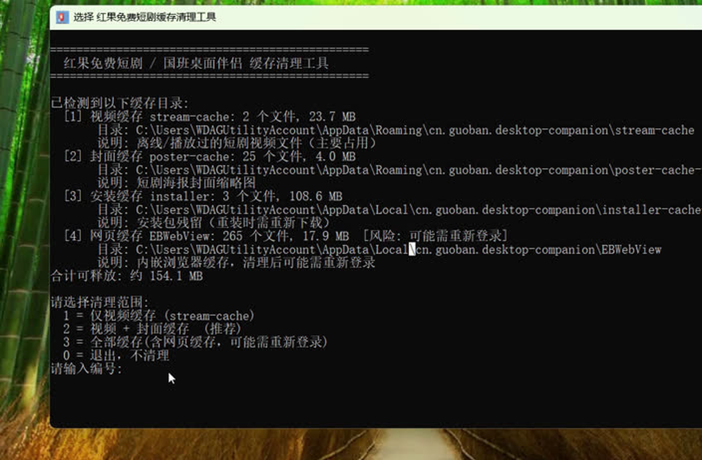
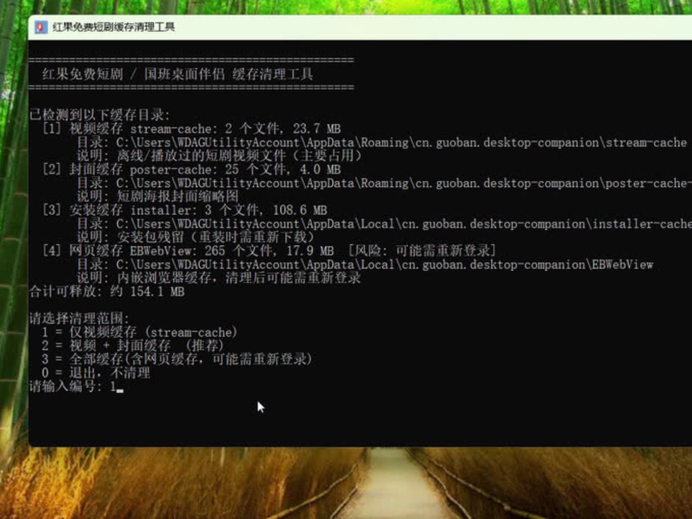

# Short Drama Cache Cleaner (短剧缓存清理工具)

一个清理「红果免费短剧」桌面版（`cn.guoban.desktop-companion`）本地缓存的第三方小工具。纯本地运行，无网络请求，不修改应用本体，只删除缓存文件。

> 本工具为第三方个人开发，与红果免费短剧官方无关。

## 功能

- 清理短剧视频缓存 `stream-cache`（主要占用）
- 清理封面缓存 `poster-cache-v1`
- 清理安装包残留 `installer-cache-v1`
- 可选清理内嵌浏览器缓存 `EBWebView`（清理后可能需重新登录）
- 自动定位应用数据目录，任意 Windows 电脑双击即用
- 删除前确认，被占用文件自动跳过，不误删其他数据

## 功能截图

### 命令行版





## 下载

请前往 [Releases](https://github.com/fengcv/short-drama-cache-cleaner/releases) 页面下载最新版本：

| 文件 | 说明 |
|---|---|
| `clean-guo-cache-gui.exe` | **图形界面版（推荐）**：窗口界面，勾选 + 按钮操作 |
| `clean-guo-cache.exe` | 命令行版：轻量，支持 `-Force` / `-Preview` 参数 |

## 使用方法

### 图形界面版（推荐）

双击 `clean-guo-cache-gui.exe`，窗口内勾选要清理的缓存（默认全选，网页缓存默认不勾），点击「开始清理」即可。

### 命令行版

双击 `clean-guo-cache.exe`，输入编号选择清理范围：

1. 选择清理范围：`1` 仅视频缓存 / `2` 视频+封面缓存（推荐）/ `3` 全部缓存 / `0` 退出
2. 输入 `Y` 确认后开始清理
3. 查看清理报告

命令行参数：

```
clean-guo-cache.exe -Force    # 跳过交互，直接清理视频缓存
clean-guo-cache.exe -Preview  # 只预览占用，不删除
```

## 文件校验

Release 页面附有 SHA-256 校验值，下载后请核对，防止文件被篡改。

## 免责声明

- 本工具仅用于清理本机缓存，不涉及破解、逆向或修改应用；
- 缓存清理后应用会自动重建，不影响正常使用；
- 使用本工具造成的任何后果由使用者自行承担。
